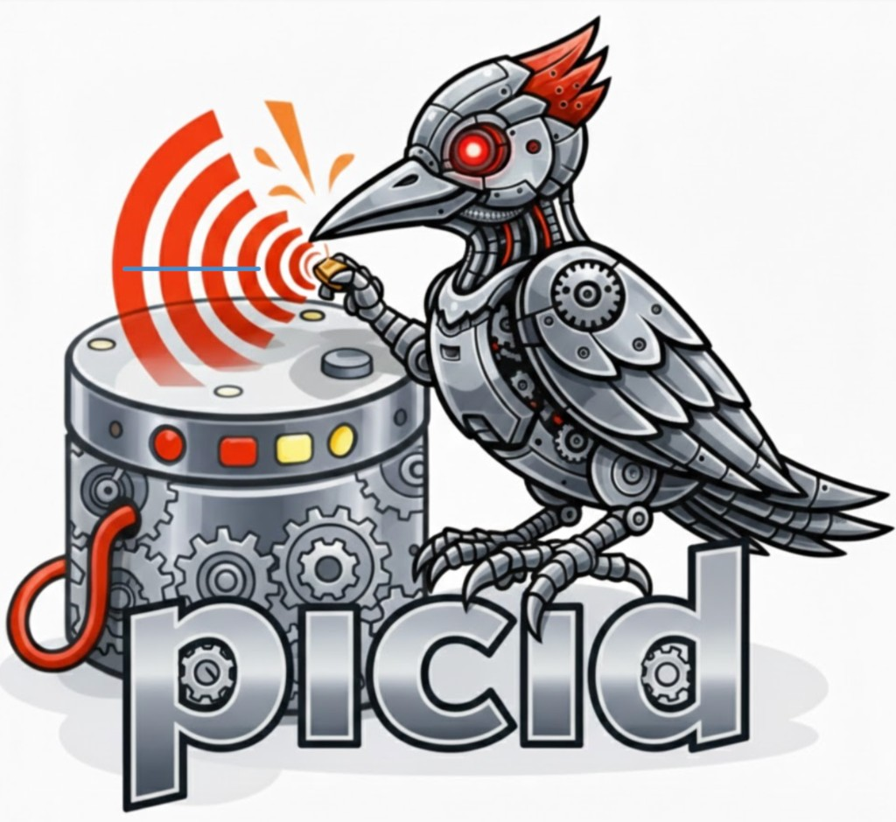

# TabPHM



**TabPHM** (piCID) is the Prognostics, Health Management (PHM) and Forecasting Benchmark Arena. *About:* A unified, config-driven framework for PHM and forecasting experiments—from data loading to evaluation. It provides a unified framework for loading datasets, preprocessing with configurable transforms, training and evaluating models (including fit-predict and batchwise regimes), and running experiments locally or on a cluster.

---

## Start here

- **[Getting started](getting-started/index.md)** — Install, set paths, run your first experiment, and use the [dataset viewer](getting-started/viewer.md).

---

## Learn the framework

- **[Concepts](concepts/index.md)** — How the framework works: [From data to prediction](concepts/from_data_to_prediction.md) (datasource → data objects → datasets → transforms → model → evaluator → pipeline).
- **[Examples](examples/index.md)** — End-to-end example: [Unibo battery RUL](examples/unibo_rul.md) (config groups and transform overrides).

---

## Reference

- **[Reference](reference/index.md)** — Datasources, data objects, datasets, transforms, evaluators, model types, and [API](reference/api.md).

---

## Documentation map

| Section | Description |
|--------|-------------|
| [Getting started](getting-started/index.md) | [Setup](getting-started/setup.md), [Dataset viewer](getting-started/viewer.md). |
| [Concepts](concepts/index.md) | [From data to prediction](concepts/from_data_to_prediction.md) — data flow in one PHM run. |
| [Guides](guides/index.md) | [Config and overrides](guides/configs_and_overrides.md), [OmegaConf resolvers](guides/omegaconf_resolvers.md), [Adding a model](guides/how_to_add_a_new_model.md), [RunAI](guides/runai.md). |
| [Examples](examples/index.md) | [Unibo RUL](examples/unibo_rul.md) — battery RUL with config variants. |
| [Reference](reference/index.md) | Datasources, datasets, transforms, evaluators, model types, API. |

---

## Quick start

1. **Install** — Follow [Setup](getting-started/setup.md) (install `uv`, clone with submodules, `uv sync`, `uv pip install -e ".[dev]"`).
2. **Paths** — Create a path config in `configs/paths` (e.g. copy `default.yaml`) and set your data/experiment roots.
3. **Run** — From the project root:
   ```bash
   source .venv/bin/activate
   python picid/run.py paths=<your_paths> experiment=<experiment_key>
   ```
   Example: `experiment=unibo/prognostics/raw/cnn_1d`. Use `debug=default` for faster runs during development.

For cluster runs, see [RunAI](guides/runai.md).
